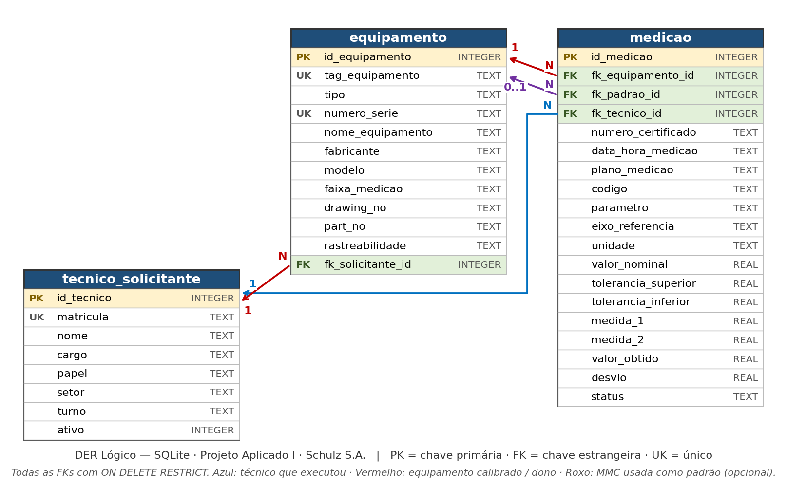

# Estrutura do Banco de Dados Relacional — Projeto Schulz S.A.

## 1. Contexto Operacional e Objetivo
O objetivo deste projeto é modernizar a gestão e emissão de certificados de calibração no laoratório da da **Schulz S.A.**, migrando a operação manual, realizada através de planilhas eletrônicas, para um processo automatizado, utilizando o **Banco de Dados Relacional em SGBD SQLite**.

A arquitetura foi desenhada para eliminar redundâncias, garantir a rastreabilidade integral das medições colhidas nas Máquinas de Medição por Coordenadas (MMC) e automatizar a emissão dos Certificados de Calibração, assegurando rigorosa conformidade com a norma **ABNT NBR ISO/IEC 17025:2017**.

## 2. Modelagem dos dados em 3 Entidades Principais
Para atender ao escopo físico do Desafio 02 no SQLite, as entidades de negócio foram consolidadas de forma otimizada em **3 tabelas integradas**:

1. **`tecnico_solicitante`**:
   - Unifica as pessoas e departamentos envolvidos. O campo `papel` (`CHECK ('METROLOGISTA', 'SIGNATARIO', 'SOLICITANTE')`) diferencia o metrologista que executa o ensaio, o responsável técnico que assina o certificado e setor solicitante.
   - Inclui controle de status do funcionário ou departamento por meio do campo `ativo` (0 ou 1).

2. **`equipamento`**:
   - Consolida em uma única estrutura os equipamentos ou dispositivos inspecionados e as próprias Máquinas de Medição por Coordenadas (MMC) utilizadas como padrão.
   - O campo `tipo` (`'MMC'` ou `'INSTRUMENTO'`) categoriza o dispositivo.
   - Guarda TAG único, número de série, fabricante, modelo, especificações do desenho (`drawing_no`), código de peça (`part_no`), dados de rastreabilidade e a referência (`fk_solicitante_id`) ao setor ou responsável proprietário.

3. **`medicao`**:
   - Registra o resultado dimensional de cada característica aferida no software de medição.
   - Realiza a amarração de rastreabilidade através de 3 Chaves Estrangeiras (`FK`):
     - `fk_equipamento_id` $\rightarrow$ Equipamento ou peça que foi calibrada.
     - `fk_padrao_id` $\rightarrow$ Máquina MMC / Padrão utilizado no ensaio.
     - `fk_tecnico_id` $\rightarrow$ Metrologista responsável pela execução.
   - Consolida dados do certificado, plano de medição, tolerâncias, valores lidos, desvios e o status final (`'APROVADO'`, `'REPROVADO'`, `'PENDENTE'`).

## 3. Integridade de Dados, Validações e Normalização
A solução resolve os problemas de consistência e integridade dos dados no modelo em planilhas através da aplicação de restrições nativas do SGBD:

* **Validação Automática de Desvios:** O banco de dados garante matematicamente a consistência dos cálculos através da restrição `CHECK (abs(desvio - (valor_obtido - valor_nominal)) < 0.000001)`.
* **Prevenção de Duplicidade:** A restrição composta `UNIQUE (fk_equipamento_id, data_hora_medicao, codigo)` impede a inserção duplicada de uma mesma característica para o mesmo equipamento no mesmo instante de medição.
* **Integridade Referencial:** Restrições `FOREIGN KEY ... ON DELETE RESTRICT` e a instrução `PRAGMA foreign_keys = ON;` impedem a exclusão acidental de equipamentos ou técnicos que possuam histórico de medição.
* **Otimização de Consultas:** Criação de Índices secundários (`idx_equipamento_solicitante`, `idx_medicao_equipamento` e `idx_medicao_tecnico`) para acelerar a geração de relatórios e pesquisas de histórico metrológico.

## 4. Diagrama ER Conceitual

