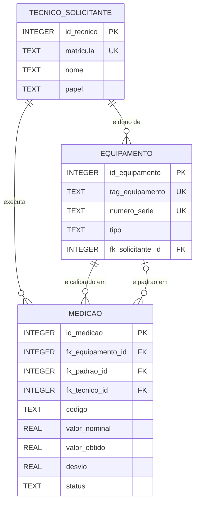

# Estrutura do Banco de Dados — Projeto Aplicado I (Schulz S.A.)

**UniSENAI · ADS · Projeto Aplicado I — Entrega 02: Modelagem e Implementação de Banco de Dados**
Prof. MSc. Hugo Menezes Barra · Empresa parceira: Schulz S.A.

## 1. Contexto

Na Entrega 01 mapeamos o processo de emissão de certificados de calibração do laboratório de metrologia da Schulz. Hoje ele depende de planilhas Excel copiadas e coladas entre arquivos, o que causou anomalias como desvios digitados à mão, unidades divergentes e cadastros repetidos.
Nesta entrega, o Banco de Dados Relacional (SQLite) passa a ser a **fonte única de verdade**: os dados de equipamentos, técnicos e medições ficam guardados com histórico, integridade e segurança.

## 2. As 3 entidades principais

O banco foi dividido em três entidades. Cada uma responde a uma pergunta do processo de calibração.

| Entidade (tabela) | Pergunta que responde | O que armazena |
|---|---|---|
| `tecnico_solicitante` | **Quem** mediu, conferiu, assinou ou pediu o serviço? | Matrícula, nome, cargo, papel (metrologista, signatário ou solicitante), setor e turno |
| `equipamento` | **O que** foi calibrado e **com o quê**? | TAG, nome, tipo (MMC ou instrumento), número de série, fabricante, modelo, faixa de medição e rastreabilidade do padrão |
| `medicao` | **Qual** foi o resultado de cada característica? | Parâmetro, valor nominal, tolerâncias, medidas 1 e 2, valor obtido, desvio, unidade e status |

### 2.1 Relacionamentos

- Um **equipamento** pode ter **muitas medições** (`medicao.fk_equipamento_id` → `equipamento.id_equipamento`). Esta é a ligação entre equipamentos e medições exigida no roteiro.
- Uma medição também aponta, de forma opcional, para a **MMC usada como padrão** (`medicao.fk_padrao_id` → `equipamento.id_equipamento`). Por isso a MMC fica na mesma tabela dos demais equipamentos, distinguida pelo campo `tipo`.
- Um **técnico** pode executar **muitas medições** (`medicao.fk_tecnico_id` → `tecnico_solicitante.id_tecnico`).
- Um **solicitante** pode ser dono de **vários equipamentos** (`equipamento.fk_solicitante_id`, opcional: nulo para equipamento interno).

### 2.2 Diagrama (Mermaid)

### 2.2 Diagrama Entidade e Relacionamento - Modelo Lógico

## 3. Por que evitar dados duplicados

Nas planilhas atuais, a mesma informação era digitada várias vezes: o nome do metrologista, os dados do equipamento, o número de série. Isso gera quatro problemas:

1. **Inconsistência:** o mesmo técnico ou setor aparece com grafias diferentes ("Metrologia", "METROLOGIA ", "Metrol."), e uma consulta por nome deixa de encontrar tudo.
2. **Manutenção cara:** corrigir um dado repetido em muitos lugares exige alterar todos, e basta esquecer um para o banco se contradizer.
3. **Risco em auditoria:** numa auditoria ISO/IEC 17025 não pode haver duas versões do mesmo dado. O certificado precisa ser rastreável até um único registro do equipamento e do técnico.
4. **Erros de digitação:** cada cópia manual é uma chance de erro, como os desvios que não batiam com a conta (valor obtido − nominal) na análise da Entrega 01.

**Como o modelo evita a duplicidade:**

- Cada técnico e cada equipamento são cadastrados **uma única vez**; as medições apenas **referenciam** o cadastro por chave estrangeira (FK).
- Restrições `UNIQUE` em matrícula, TAG e número de série impedem cadastros repetidos.
- A restrição `UNIQUE (fk_equipamento_id, data_hora_medicao, codigo)` impede a mesma característica de ser lançada duas vezes na mesma calibração.
- `ON DELETE RESTRICT` impede apagar um técnico ou equipamento que já tenha histórico, preservando a rastreabilidade.
- Um `CHECK` garante que `desvio = valor_obtido − valor_nominal`, o que elimina o desvio digitado à mão.

## 4. Decisões de projeto e limitações assumidas

- **Chaves numéricas** (`INTEGER PRIMARY KEY`): mais leves e rápidas que texto, e o SQLite as numera automaticamente.
- **Datas em texto ISO 8601** (`AAAA-MM-DD HH:MM:SS`): o SQLite não tem tipo de data próprio, e esse formato ordena corretamente.
- **Tolerâncias aceitam nulo**, porque há características com tolerância unilateral (por exemplo, planicidade).
- **Unidade explícita** (`mm`, `um`, `graus`): evita o erro de 1000× entre mm e µm encontrado nas planilhas.
- **Parâmetro e valor nominal ficam em `medicao`**, e não em `equipamento`: um equipamento tem vários parâmetros, cada um com seu nominal. Em `equipamento` eles forçariam uma linha por parâmetro, repetindo TAG e número de série.
- **Limitação consciente:** como o roteiro pede 3 tabelas, os dados que se repetem por calibração (`numero_certificado`, `data_hora_medicao`, `fk_tecnico_id`, `plano_medicao`) ficam na `medicao`, uma linha por característica.

## 5. Evolução prevista (fora do escopo desta entrega)

Numa fase seguinte, o modelo pode ser refinado para a 3FN completa, separando essas informações em uma tabela `certificado_calibracao`. Também está prevista uma tabela `parametro_equipamento`, que guardaria uma única vez o parâmetro e o valor nominal de cada equipamento, e uma tabela `incerteza_medicao` (incerteza expandida e fator k, conforme GUM/EA-4/02). Fica registrado aqui para não se perder o estudo do modelo de 7 entidades já desenhado pelo grupo.